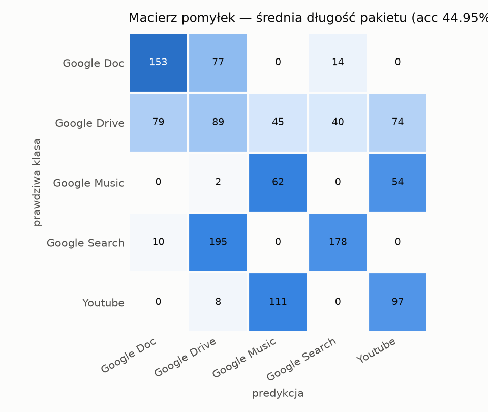
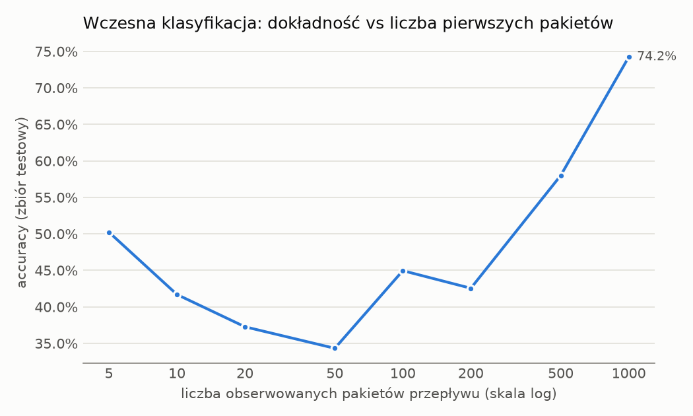
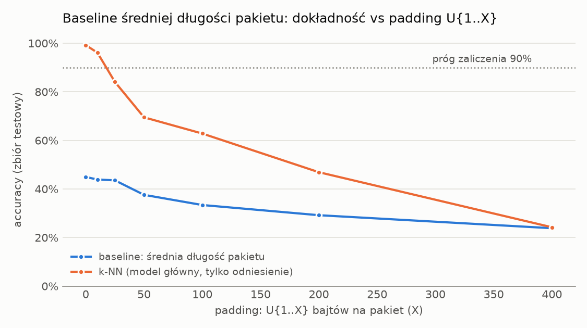
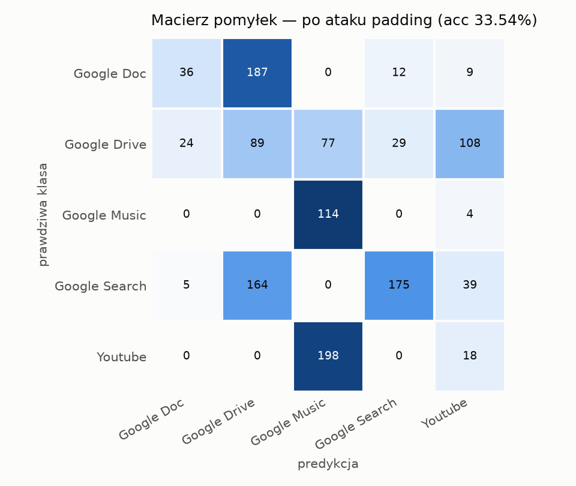

# Baseline: klasyfikator średniej długości pakietu

*Wygenerowano automatycznie: 2026-10-12 17:51*

Dummy własny (`MeanPacketLengthClassifier`): jedna cecha — średni rozmiar pakietu (z pierwszych 100 pakietów). Predykcja = klasa o najbliższej średniej tej cechy na zbiorze treningowym.

Podział train/test zgodny z modelem głównym: `models/knn.joblib` (bez ponownego treningu k-NN).

## Podsumowanie

| Miara | Wartość |
|---|---|
| Accuracy (czysty test) | **44.95%** |
| Macro-F1 | 0.4545 |
| Accuracy po ataku padding U{1..100} B | 33.56% ± 0.08 pp |
| k-NN główny (czysty test, z metrics.json) | 99.22% |

## Wyniki na czystym zbiorze testowym

| Klasa | Kategoria | Precision | Recall | F1 | Liczność |
|---|---|---|---|---|---|
| Google Doc | edycja dokumentów (web app) | 0.6322 | 0.6270 | 0.6296 | 244 |
| Google Drive | transfer plików | 0.2399 | 0.2722 | 0.2550 | 327 |
| Google Music | streaming audio | 0.2844 | 0.5254 | 0.3690 | 118 |
| Google Search | przeglądanie WWW | 0.7672 | 0.4648 | 0.5789 | 383 |
| Youtube | streaming wideo | 0.4311 | 0.4491 | 0.4399 | 216 |

## Wczesna klasyfikacja (ile pakietów wystarczy?)

| Pierwsze N pakietów | Accuracy |
|---|---|
| 5 | 50.23% |
| 10 | 41.69% |
| 20 | 37.27% |
| 50 | 34.32% |
| 100 | 44.95% |
| 200 | 42.55% |
| 500 | 58.00% |
| 1000 | 74.22% |

## Atak padding

| Maks. padding X [B] | baseline średniej długości | k-NN (odniesienie) |
|---|---|---|
| 0 | 44.95% | 99.22% |
| 10 | 43.87% | 96.12% |
| 25 | 43.56% | 84.08% |
| 50 | 37.58% | 69.49% |
| 100 | 33.39% | 62.81% |
| 200 | 29.19% | 46.89% |
| 400 | 23.84% | 24.22% |

