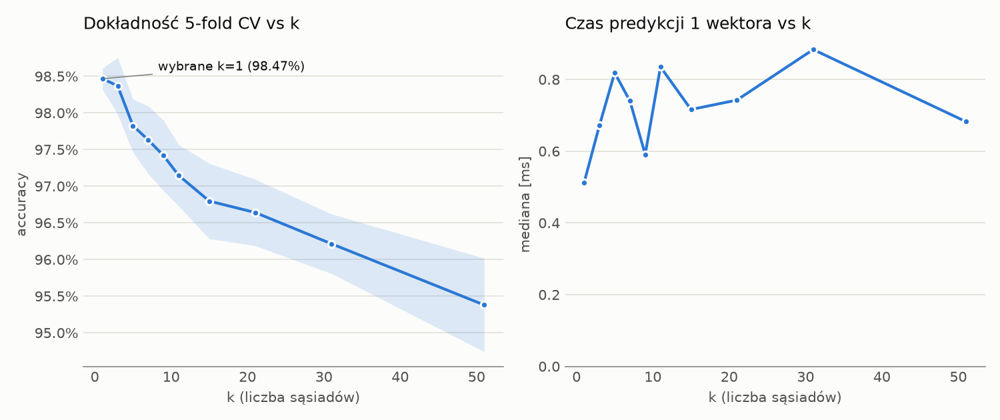
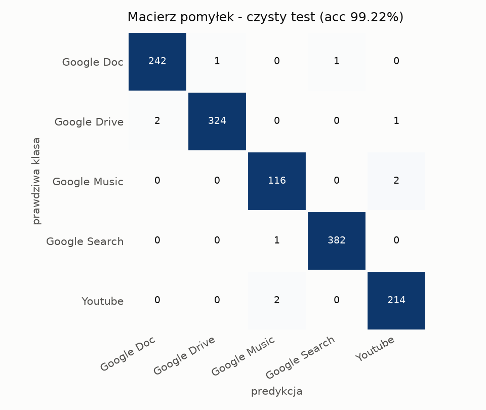
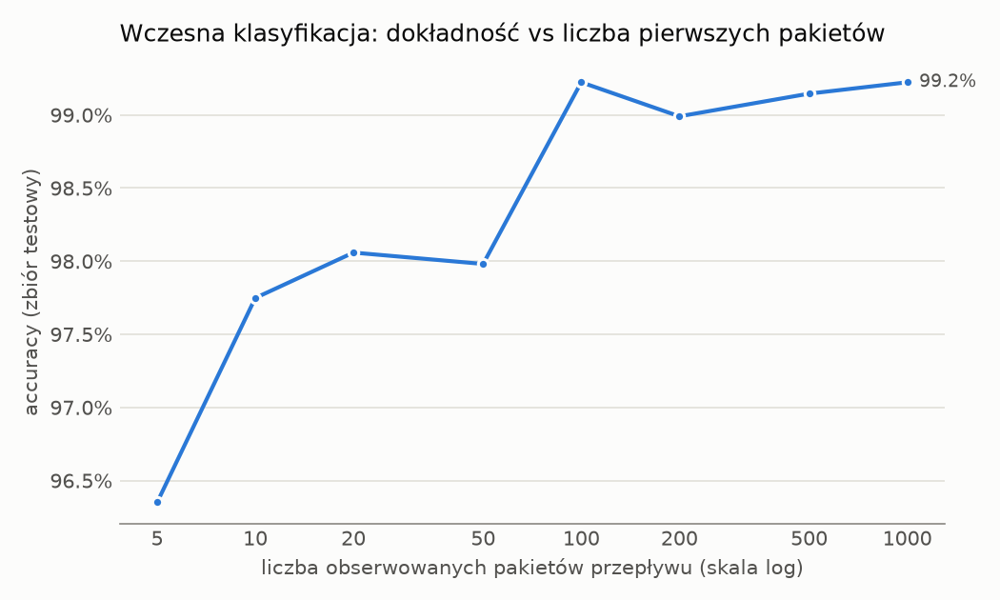
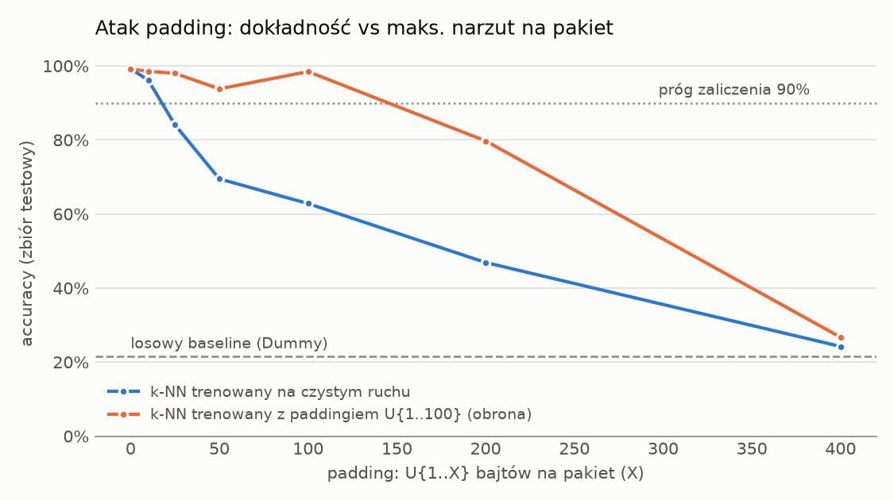
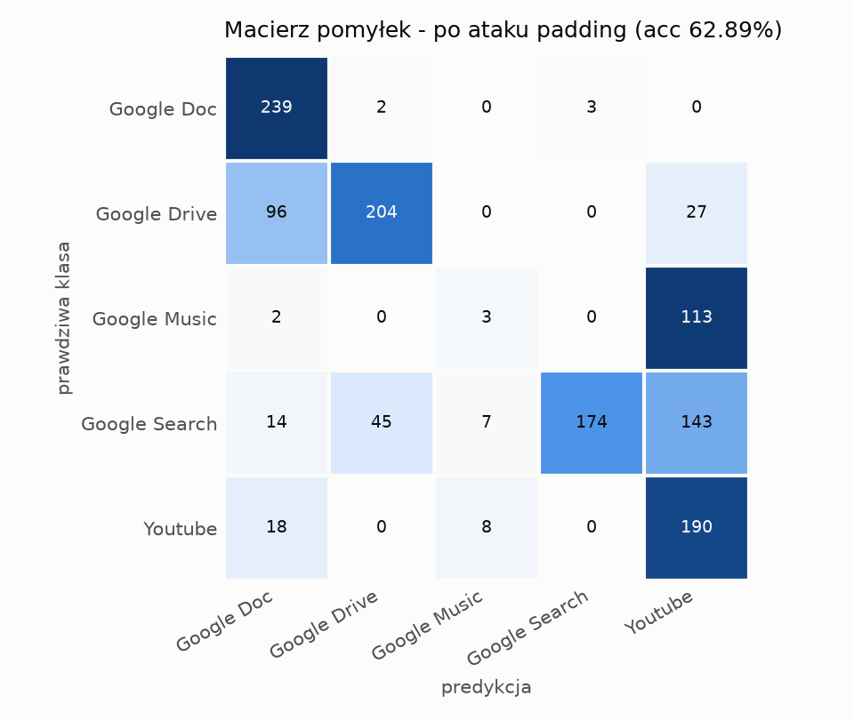

# Raport z eksperymentu - k-NN dla ruchu szyfrowanego (UC Davis QUIC)

*Wygenerowano automatycznie: 2026-10-12 12:23*

## Podsumowanie

| Miara | Wartość |
|---|---|
| Accuracy k-NN (czysty test) | **99.22%** |
| Macro-F1 | 0.9901 |
| Accuracy Dummy (losowy, uniform) | 21.51% |
| Accuracy po ataku padding U{1..100} B | 62.73% ± 0.38 pp |
| Spadek skuteczności po ataku | 36.5 pp |
| Wybrane k | 1 |
| Czas predykcji 1 przepływu (mediana / p99) | 0.70 ms / 0.97 ms |
| Hipoteza (accuracy > 90%) | **POTWIERDZONA** |

## Dane

- Przepływów: 6439, podział hold-out 80/20, stratified (train 5151, test 1288), seed 42.
- Klasy: Google Doc - edycja dokumentów (web app) (1221), Google Drive - transfer plików (1634), Google Music - streaming audio (592), Google Search - przeglądanie WWW (1915), Youtube - streaming wideo (1077).
- Cechy: 55-wymiarowy wektor statystyk rozmiarów pakietów i inter-arrival times (osobno dla kierunku upstream/downstream) z pierwszych 100 pakietów przepływu.

## Dobór k (5-fold CV na zbiorze treningowym)

| k | CV accuracy | odch. std. | czas predykcji 1 wektora [ms] |
|---|---|---|---|
| **1** | 0.9847 | 0.0014 | 0.512 |
| 3 | 0.9837 | 0.0039 | 0.671 |
| 5 | 0.9783 | 0.0036 | 0.819 |
| 7 | 0.9763 | 0.0046 | 0.740 |
| 9 | 0.9742 | 0.0048 | 0.591 |
| 11 | 0.9715 | 0.0042 | 0.835 |
| 15 | 0.9680 | 0.0051 | 0.716 |
| 21 | 0.9664 | 0.0045 | 0.742 |
| 31 | 0.9621 | 0.0041 | 0.883 |
| 51 | 0.9538 | 0.0064 | 0.682 |

Reguła wyboru: najmniejsze k, którego dokładność CV jest nie gorsza niż 0.2 pp od najlepszej (mniejsze k = mniej sąsiadów do głosowania i mniejsza wrażliwość na nierównowagę klas).

## Wyniki na czystym zbiorze testowym

| Klasa | Kategoria | Precision | Recall | F1 | Liczność |
|---|---|---|---|---|---|
| Google Doc | edycja dokumentów (web app) | 0.9918 | 0.9918 | 0.9918 | 244 |
| Google Drive | transfer plików | 0.9969 | 0.9908 | 0.9939 | 327 |
| Google Music | streaming audio | 0.9748 | 0.9831 | 0.9789 | 118 |
| Google Search | przeglądanie WWW | 0.9974 | 0.9974 | 0.9974 | 383 |
| Youtube | streaming wideo | 0.9862 | 0.9907 | 0.9885 | 216 |

## Grupa kontrolna (baseline)

| Klasyfikator | Accuracy | Macro-F1 |
|---|---|---|
| k-NN (k=1) | 99.22% | 0.9901 |
| Dummy (uniform) | 21.51% | 0.2086 |
| Dummy (stratified) | 23.68% | 0.2086 |
| Dummy (most_frequent) | 29.74% | 0.0917 |

## Wczesna klasyfikacja (ile pakietów wystarczy?)

Dla każdego N trenowany jest osobny model k-NN na cechach z pierwszych N pakietów. Modele oznaczone jako etap są częścią klasyfikatora w locie: dają wstępną decyzję zanim przepływ osiągnie 100 pakietów.

| Pierwsze N pakietów | Accuracy | Etap klasyfikatora w locie |
|---|---|---|
| 5 | 96.35% |  |
| 10 | 97.75% | tak |
| 20 | 98.06% | tak |
| 50 | 97.98% | tak |
| 100 | 99.22% | tak |
| 200 | 98.99% |  |
| 500 | 99.15% |  |
| 1000 | 99.22% |  |

## Atak padding

Do rozmiaru każdego pakietu w zbiorze testowym dodano losowo od 1 do 100 B (5 powtórzeń z różnym ziarnem). Model trenowany na czystym ruchu: **62.73%** (spadek o 36.5 pp).

| Maks. padding X [B] | k-NN (trening czysty) | k-NN (trening z paddingiem) |
|---|---|---|
| 0 | 99.22% | 99.15% |
| 10 | 96.12% | 98.52% |
| 25 | 84.08% | 97.98% |
| 50 | 69.49% | 93.79% |
| 100 | 62.81% | 98.45% |
| 200 | 46.89% | 79.74% |
| 400 | 24.22% | 26.71% |

## Wydajność

- Trening (zapamiętanie 5151 wektorów + skaler): 5.9 ms
- Ekstrakcja cech: 0.36 ms / przepływ
- Predykcja pojedynczego przepływu (ekstrakcja + k-NN): mediana 0.70 ms, p95 0.84 ms, p99 0.97 ms, max 1.13 ms
- Przepustowość wsadowa: 145845 przepływów/s
- Środowisko: Python 3.14.5, scikit-learn 1.9.1, Windows-11-10.0.26200-SP0
